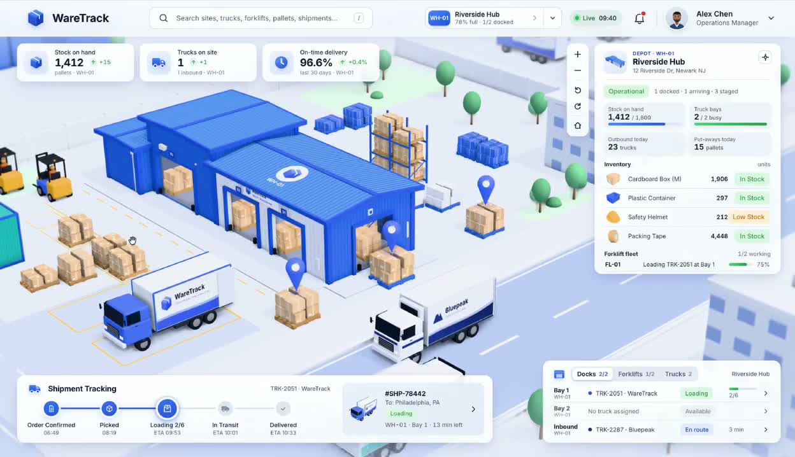

# WareTrack 3D — 3D Logistics Control Tower

A 3D logistics / warehouse control-tower demo: an isometric, soft-pastel 3D city with five
warehouse sites, live trucks, forklifts and pallets, and a glassy white operations overlay
(KPIs, detail panels, shipment tracking, fleet tabs). All data is mock — the simulation runs
live in the browser.

Built with **Vite + three.js** (plain JavaScript, ES modules, no framework).



## Features

- **Isometric 3D warehouse network** — five sites (depot, distribution center, cold chain,
  cross-dock, automated robotics hub), each with its own building variant, docks, staging
  slots, chargers and yard. Pan/rotate/zoom the whole city; site-to-site camera flyovers.
- **Live simulation** — trucks drive in, reverse into dock bays, load/unload; forklifts
  shuttle pallets between truck rears and staging slots; batteries charge; the clock ticks;
  statuses, ETAs and counters update in real time.
- **Glassy overlay UI** — top bar with global search + site switcher + live clock, three KPI
  cards, map controls, a detail panel that cross-fades per entity, shipment tracking stepper,
  and a fleet panel with Docks / Forklifts / Trucks tabs.
- **Mobile / portrait responsive** — a native phone layout below 820 px: compact top bar,
  horizontal KPI strip, thumb-reachable map controls on the right edge, and a single tabbed
  bottom sheet (Details / Fleet / Shipment). Touch: one-finger pan, two-finger pinch-zoom +
  twist to orbit, tap to select, tap empty ground to close.
- **Installable PWA** — `manifest.json` (standalone, theme color, 192/512/maskable icons) +
  a service worker that caches the app shell for offline / fast reload.
- **Hindi + English onboarding tutorial** — a dismissible first-load overlay (re-openable via
  the **?** Help button) with a live EN ⇄ हिं toggle. All tutorial text uses the **Poppins**
  font; every instruction is derived from the app's actual controls.
- **Indian warehouse goods** — mock inventory uses real Indian godown goods: UltraTech
  cement bags, Sona Masoori rice, Aashirvaad wheat atta, neem-coated urea, TMT steel rods,
  sunflower edible oil, HUL FMCG cartons, HPCL LPG cylinders, Kajaria ceramic tiles.

## Run locally

```bash
npm install
npm run dev      # http://localhost:5173
```

Production build and preview:

```bash
npm run build    # outputs to dist/
npm run preview  # serve the built dist/ at http://localhost:4173
```

### Deep links

Open straight to a site, object or fleet tab via query params:

- `/?site=WH-04&select=truck:TRK-2205&tab=trucks`
- `/?site=ALL` — network overview (all five sites)
- `/?select=forklift:FL-01`

## Controls

### Desktop

- **Left-drag** — pan the map · **right-drag** — rotate/orbit · **scroll** — zoom to cursor
- **+ / −** zoom · **⟲ / ⟳** rotate · **⌂** reset to the current site view
- **Hover** a truck, forklift, pallet, dock, charger or building → floating label. **Click**
  → select it, camera eases in, detail panel opens. **✕** or **Esc** closes the panel.
- **Site switcher** (top bar): `›` next site, `⌄` dropdown (incl. *ALL · Network overview*)
- **Search:** press `/` and type (e.g. `TRK-2205`, `FL-12`, `cement`)
- **Vehicle panel:** **⌖** locate on map · **↗** camera follows the vehicle as it moves

### Mobile / touch

- **One finger** — pan · **two fingers** — pinch to zoom + twist to orbit
- **Tap** an object → label + detail panel. **Tap** the **✕** or **tap empty ground** → close
- Same **+ / − / ⟲ / ⟳ / ⌂** buttons (right edge, enlarged for thumbs)
- **Search icon** in the top bar opens a full-width search sheet
- Bottom sheet tabs: **Details / Fleet / Shipment** (tap a fleet row to fly to that entity)

## Project structure

| Path | Contents |
|---|---|
| `index.html` | App shell: viewport + UI mount, PWA manifest/SW links, Inter + Poppins fonts |
| `src/main.js` | Bootstrap: wires scene, world, simulation, camera director, interaction, UI |
| `src/data/mockData.js` | Mock ERP dataset: sites, SKUs, carriers, trucks, forklifts, pallets, docks, chargers, shipments, notifications |
| `src/data/db.js`, `selectors.js`, `format.js` | Data access layer, derived views (KPIs, progress, queues), formatting + status vocabulary |
| `src/data/layout.js` | Spatial layout: dock/slot/charger poses, routes, per-site camera views |
| `src/state/store.js` | UI state + event bus (`store`, `bus`) |
| `src/state/simulation.js` | Operations simulation: gate → dock → load/unload, forklifts, charging, clock |
| `src/three/` | Scene, camera director, interaction (picking + labels), world, models (`models/`) |
| `src/ui/` | Overlay UI: topbar, KPIs, map controls, detail panel, fleet panel, shipment tracker, tutorial |
| `public/` | `manifest.json`, `sw.js`, PWA icons (192/512/maskable + apple-touch + favicon) |
| `vercel.json`, `.vercelignore` | Vercel deployment config (Vite framework, PWA cache headers) |
| `docs/SPEC.md` | Build spec + module contracts |
| `scripts/gen-icons.mjs` | Regenerates the PWA icons from the brand cube (uses `sharp`) |

## Deploy on Vercel

The repo is Vercel-ready. `vercel.json` locks the framework to **Vite** (`vite build` → `dist/`)
and sets the headers a PWA needs:

- `/sw.js` → `no-cache, must-revalidate` + `Service-Worker-Allowed: /` (service worker always
  updates, can scope the root domain)
- `/manifest.json` → `application/manifest+json` content-type
- `/assets/*` → `max-age=31536000, immutable` (hashed filenames)
- icons → 7-day cache

**Steps:**

1. Push this repo to GitHub.
2. https://vercel.com → **Add New… → Project** → import the repo.
3. Vercel auto-fills Build (`vite build`), Output (`dist`), Install (`npm install`). Click **Deploy**.
4. Open the production URL on Chrome Android → **Install** (Add to Home Screen) is available.

No environment variables or credentials are required.

## Connect to a real ERP / WMS

The UI and 3D layer only read data through `db.js` and `selectors.js`. To wire a real system:

1. Replace `mockData.js` with data fetched from your API, keeping the same field names.
2. Feed real vehicle positions (GPS/RTLS) into `position` / `heading`, or let `simulation.js`
   interpolate between milestones.
3. Whenever data changes, call `bus.emit('data:update')` — the UI updates live without
   re-rendering.

See `docs/SPEC.md` for the full module contracts (data shapes, events, camera commands).

## Tech

- **Vite 8** + **three.js r186** (ES modules, addons from `three/addons/...`)
- Plain JavaScript, no TypeScript, no UI framework
- Soft pastel "clay" look: `PCFShadowMap`, `NeutralToneMapping`, `HemisphereLight` + key
  `DirectionalLight`, procedural `RoomEnvironment` ambient

## License

Demo project. Reference video and `docs/ref/*` frames are for development reference only.
